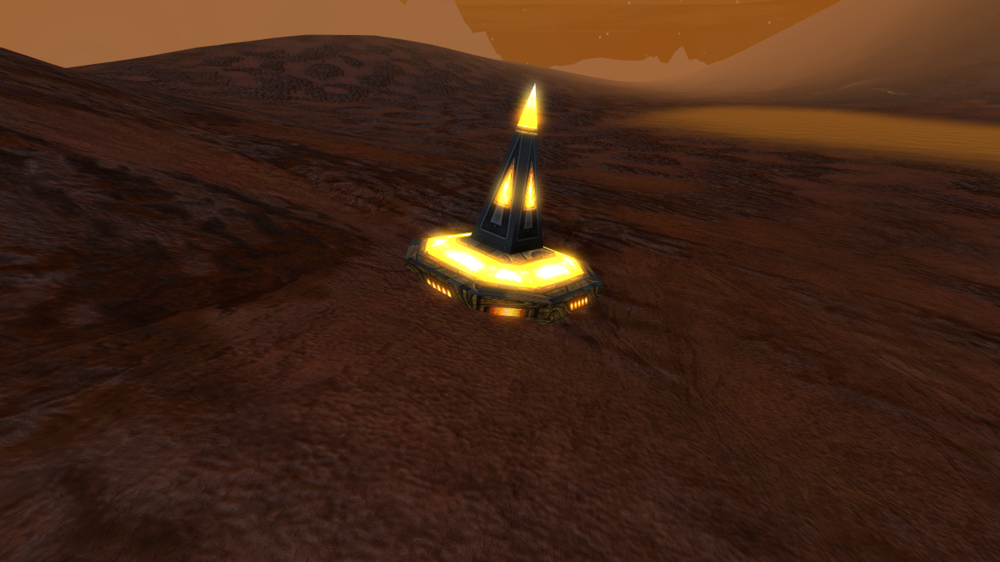
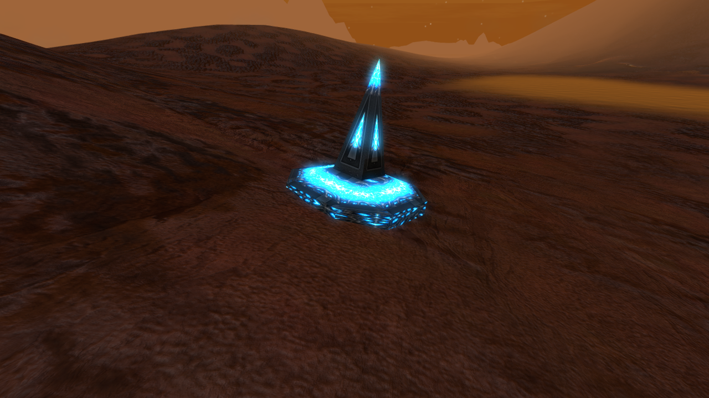

# Olympian and Fury arc mines

Owner amendment, 16-17 October 2026: distinguish the ancient Mars mine from the
later Fury version in appearance, armament and damage. The stock inspection
text `boltmine.inf` explicitly says the Fury mine delivers much more damage
than the Olympian version. The exact ratio and new visual treatment below are
CR design choices, not invented stock lore.

| | Olympian | Fury |
| --- | --- | --- |
| ODF/model | `cromine` | `crfmine` |
| Hull | Aged golden bronze, sweeping engraved seams, amber energy apertures | Dark ribbed biomechanical metal, cyan energy apertures |
| Weapon | Olympian Sun Arc (`cromarc` / `crom0`) | Fury Storm Arc (`crfmarc` / `crfm0`) |
| Discharge | Narrow amber filament, restrained movement | Two thicker cyan strands, short jagged segments and wider forks |
| Native beam damage coefficient | 40 | 100 (stock Fury strength) |
| Scan / weapon range | 100 m / 100 m | 100 m / 100 m |
| Mine health / scrap value | 1000 / 0 | 1000 / 0 |

Both remain clearable, persistent defensive mines with no ammo exhaustion. The
Fury version's coefficient is 2.5 times the Olympian version. This is a beam
coefficient, not a claim of 100 damage per second; native firing timing determines
actual continuous damage.

The fresh diffuse atlases use the stock mine's UV layout. Lenmos/`oblema` supplied
Olympian art direction; the stock Fury models supplied Fury art direction. The
original low-detail mine diffuse is a layout guide, not the new painted surface.
Each variant also has a fresh emission atlas; a newly generated neutral filament
is independently colored/shaped by the two native render definitions. A dedicated
additive sprite material binds that filament for the native effect renderer.
Short matching amber/cyan contact flashes replace the stock blue impact bubble
without adding explosion damage. The builder
performs DDS conversion only and copies the stock mesh/SDF/skeleton, changing only
the Ogre resource links. Geometry, collision, UVs, bounds and skeleton stay stock.
Source PNGs, prompts and stock hashes are under `References/BoltMines`.

## Mission selection

- Mission 05: all 23 scripted Mars volcano mines use `cromine`, preserving the
  original positions, hostile team, detection radius and clearance behavior.
- Mission 15: all forty mines in the Tartarus response use `crfmine`.
- Mission 16: all six authored mines are swapped in the BZN to `crfmine`; their
  original labels and placement stay intact. The scene builder makes the same
  substitution when rebuilding from the preserved amended map.
- Mission 17: the marked roster adapter maps both `boltmine` and `boltmine2` to
  `crfmine`, without advancing its fighter counter. Both 53-mine branches keep
  their original trigger, positions, clear/destroy handles and source order.
- Mission 14 and 18 have no authored stock arc mines. The shared later-mission
  adapter will select the Fury variant if either mine ODF is requested later.

No global override of stock `boltmine`/`gmbolt`/`mbolt` is shipped. Human mine
dispensers and unrelated maps therefore keep their existing behavior.

## Validation

`Tools/Test-BoltMines.py` checks model preservation, the independent weapon and
texture chains, damage/range, BZN swaps and shipping admission. Mission 05's
contract/presentation checks and Mission 15/16/17 regression suites cover the
integration. `Test-BoltMinesLive.ps1` is a private native fixture: it uses an
unarmed stationary tank as the target, samples each mine's damage over simulation
time, captures the hull/discharge, then checks replicated destruction. Unit AI
setters are applied only to the known tank, never to either mine.

The texture chain was verified by live material readback. The initial BC3 DDS
conversion loaded without an Ogre exception but rendered gray in native DX11;
the same artwork rendered correctly as PNG and as RGBA8 DDS. Both builders now
emit RGBA8 DDS, including the fighter atlas and arc filament. This is evidence
about these generated files on the tested native path, not a general claim that
BC3 is unsupported. No shared shader change was needed.

`mines-rgba-18` passed 9 steps / 25 checks on two native GOG clients: both mines
loaded and inflicted damage, the Fury mine was materially stronger, and both
clients observed each destruction. The final art fixture clears initial hostile craft and
holds recurring waves to keep its camera comparison separate from mission combat.
Its hidden camera pod sits off the firing line; a hidden pod still blocks shots
if placed directly between mine and target. Native discharges with the dedicated
sprite binding passed in `fury-art-final-19`: **13 steps / 30 checks**, including
the fighter's RGBA8 hull, both fighter guns and replicated destruction. Both
clients exited normally. Mine samples were 127.2578 damage / 3.258 s (Olympian)
and 329.5313 / 3.307 s (Fury). The registered filament material produces the
focused amber discharge/contact and the two-strand jagged cyan discharge/contact.
No mine-specific Ogre compile errors or rendering exceptions were observed;
stock `TestGround.material` missing-reference diagnostics remained.

Unmodified native frames from the final run:

| Olympian hull | Fury hull |
| --- | --- |
|  |  |

[Amber discharge](images/fury-assets-20261017/olympian-arc.png) /
[cyan discharge](images/fury-assets-20261017/fury-arc.png).

Full mission combat balance, Steam and Proton/Wine remain unverified prototype lanes.
