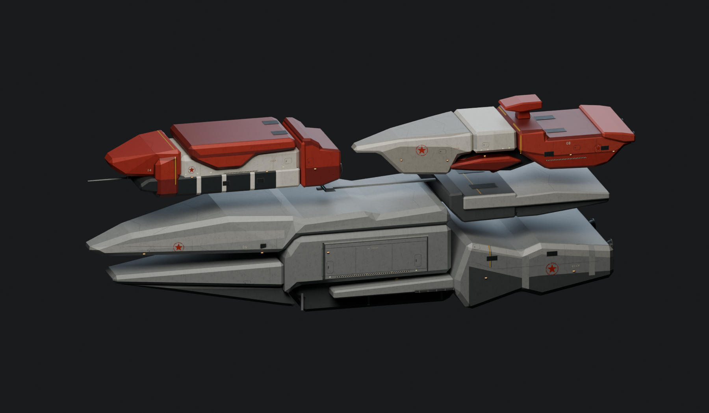

# CCA fleet surface revision — 2026-10-19

The owner rejected both the original flat blockouts and the subsequent raised
plate grids. This revision replaces that tiled treatment on all three CCA
capital ships. The NSDF carrier and the five stock scale comparisons are not
repainted or recreated.

## References and resulting construction

The installed Redux APC (`svapc`), Czar (`svtank`) and Recycler (`svrecy`) were
inspected as textured 3D meshes, including their actual UVs and split normals.
`Tools/Inspect-CCAStock.py` reproduces those private inspection renders from an
installed game; it does not copy stock meshes or atlases into the repository.
The launch pad's diffuse atlas was also inspected. The source concept remains
`CCAfleet3.webp`, with the same approximate 0.25 m/pixel scale and three hull IDs.

The relevant stock cues are broad continuous faceted armour, restrained flush
skin joints, ivory over charcoal, a narrow ochre identification band, red star
and interrupted ring markings, and concentrated dark cooling/mechanical areas.
Those cues replace the repeated raised rectangular plates and rooftop grids.
Broad paint regions now clip exactly to each visible structural triangle;
projecting only polygon corners onto a bevel produces triangular intersections
and is insufficient. Shallow authored seam paths and clipped service-hatch
outlines follow the skin without changing the silhouette into a tiled surface.

The grey carrier keeps its single large side bay and real fork opening. The
long red hull keeps its pale ribs, V-shaped dorsal cover and one low forward
spike. The pale-bow red ship retains its cabin, ventral blister and dorsal cap.
New miniature gun turrets and extra stacked bridge slabs were removed. Width
and unseen surfaces remain interpretations, not newly discovered concept views.

## Materials and exports

The original generated painted-steel swatch remains a restrained material input;
its exact built-in imagegen prompt and provenance are in
`References/CCAFleet/Materials/README.md`. Paint contrast and bump are reduced
so large facets do not read as uniformly pitted concrete. Geometry, faction
markings, UVs, shaders and per-ship bakes are authored in Blender.

Each ship has 2048-square diffuse and tangent-normal atlases plus 1024-square
specular and emissive atlases. Runtime DDS files are RGBA8 conversions of the
saved PNG sources. Normal maps use DirectX -Y, matching the game's
`cross(tangent,normal)` bitangent. Ogre vertices carry explicit unit tangents
in a 44-byte position/normal/UV/tangent buffer. The native GEO/SDF proxy retains
closed structural solids below its 4,096-entry limits; visual seam and lamp
geometry does not consume the collision budget.

Quick review without touching runtime assets:

```text
blender -b --factory-startup --python Tools/Author-CCAFleet.py -- --only crcred1 --preview-output <private-folder>
```

Full rebuild and targeted verification:

```text
python Tools/Build-CCAFleet.py --blender <blender.exe> --render
python Tools/Test-CCAFleetAssets.py
python Tools/Test-NSDFCarrierAssets.py
```

## Verification and pickup

The full rebuild is complete. Final render meshes are 12,817 triangles
(`crccarr`), 5,836 (`crcred1`) and 7,002 (`crcred2`). All three binary asset
validators pass: exported hashes, winding, unit normals/tangents, texture sizes,
non-flat normal atlases, bounds and native collision budgets. The unchanged NSDF
carrier validator also passes. Repository validation passes for 3,210 files.
The saved NSDF and CCA assemblies reopen with all image dependencies present.

Manager deployment updated exactly 21 existing resources in
`C:/BZRCoop/nsdf-carrier-20261018/content`: nine model/proxy files and twelve
textures. The footer verifies all 2,786 locked resources, with zero missing,
different or unexpected files. This revision does not update the live GOG mod.
The manager-refreshed binary cache/installer manifest changes were restored to
the branch baseline; no runtime DLL changes are part of the art revision.

Native attempt `cca-fleet-continuous-20261019-0103` was refused at preflight
because the regular GOG game was already running (PID 24220). That game was
left untouched. The attempt launched no clients and produced no new in-game
proof. Private logs are under `C:/BZRCoop/cca-redux-20261019/`:
`continuous-certified-build.log`,
`private-deploy.log`, `repository-validation.log`, `check-editable.log`, and
`native-continuous.log`. The older native images in `CONCEPT_FLEET_ASSETS.md`
show blockouts and do not validate this surface revision. Rerun the default
stationary `Tools/Test-ConceptFleetLive.ps1` scenario when no game is open;
use the private content and preview-map folders documented in that file.

Exact co-op fleet motion remains unqualified, independently of the stationary
asset-rendering smoke test. No production mission placement is added here.
Art quality requires visual review; triangle counts and loader checks do not
establish acceptance. These new neutral-light previews show the actual revised
source geometry and materials, including the continuous upper decks.



Individual reviews: [grey carrier](../References/CCAFleet/crccarr/hero.png),
[long red hull](../References/CCAFleet/crcred1/hero.png),
[pale-bow red hull](../References/CCAFleet/crcred2/hero.png).
