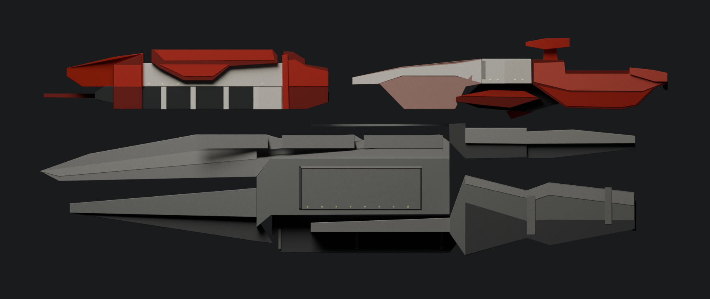
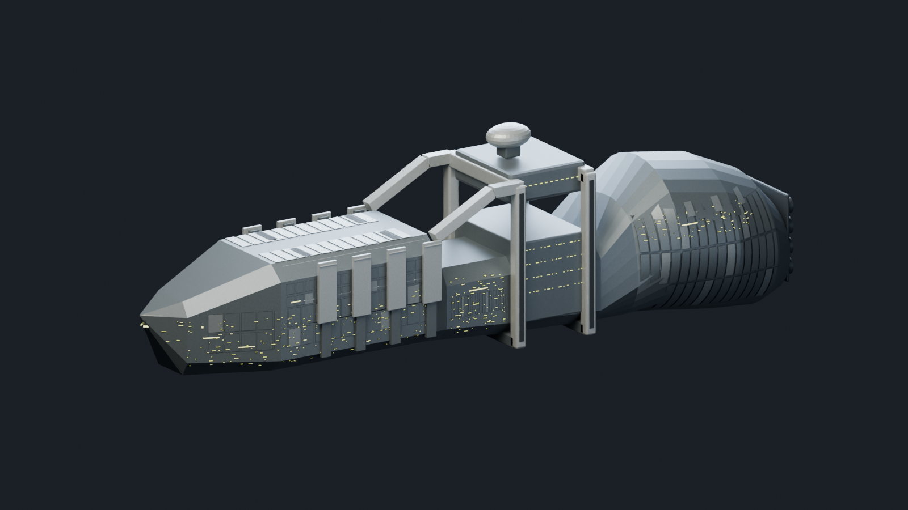

# NSDF carrier and CCA capital ships

Owner request: create cutscene ships from the private `Nsdf_carrier.webp` and
`CCAfleet3.webp` references. The owner explicitly identified the small bottom-right
group as **stock units for scale**, including `svapc`, CCA recycler, launch pad and
portal. Only the three large CCA hulls are new assets. Do not recreate or rename
the small comparison units as additional fleet classes.

| Runtime fixture | Reference element | Approximate length | Render triangles |
|---|---|---:|---:|
| `crncarr` | NSDF carrier | 243 m including inferred engines | 30,632 |
| `crccarr` | Grey fork-bow CCA carrier | 239 m | 1,912 |
| `crcred1` | Upper-left long red CCA hull | 115 m | 812 |
| `crcred2` | Upper-right pale-bow/red-aft CCA hull | 127 m | 890 |

Names describe the reference positions/shapes; they do not assert canonical ship
classes or lore. The simple CCA surfaces follow the angular, sparse concept art.
The NSDF carrier's frame opening, wedge bow and rounded aft hull use a more
detailed authored mesh. Each ship has a separate ODF, material, Ogre mesh, native
GEO/SDF and four namespaced RGBA8 atlases. All four are neutral static
`i76building` fixtures with zero maximum health, no AI and no production role.

## Scale and interpretation

The installed stock Redux `svapc.mesh` has a local Z span of 14.61861 m. Its source
silhouette occupies about 59 pixels (u764–823). That yields approximately
0.2478 m/pixel; the CCA survey uses a rounded **0.25 m/pixel** for all three ships.
The large grey hull spans u49–1007. The NSDF source has no shared scale bar; its
240 m side span is chosen to be comparable, replacing the original 600 m draft.
These are approximate staging dimensions, not newly established lore. Stock
comparison geometry/rendered perspective and drawing precision limit exactness.

The artwork establishes side outlines and broad colour blocks. Width, top/bottom
surfaces, opposite sides, small lamps and recessed aft engines are inferred. The
grey carrier's nose slot is actual open geometry. Preserve the long red hull's
lower pale ribs and deep V-shaped dorsal cover, and the other red hull's pale
wedge, cabin, dorsal sensor and lower red blister when changing detail.

Private artwork is neither copied nor committed. `geometry.json` stores source
polygons, the reference SHA-256, measured positions and interpretations. No
downloads or copied stock craft meshes are needed to rebuild these models.

## Editable sources and rebuilding

`References/NSDFCarrier/NSDF-Carrier.blend` and
`References/CCAFleet/CCA-Fleet.blend` are the editable carrier and fleet assembly.
Each CCA ship also has an individual `.blend` and baked PNGs under its runtime ID.
The assembly side render preserves the common scale and positions of the three
large reference hulls. The original five comparison units are omitted.

```text
python Tools/Build-NSDFCarrier.py --blender <blender.exe> --render
python Tools/Build-CCAFleet.py --blender <blender.exe> --render
python Tools/Test-NSDFCarrierAssets.py
python Tools/Test-CCAFleetAssets.py
```

Builders require Blender 4.5+ and Pillow. `--textures-only` converts existing PNG
bakes to RGBA8 DDS. The CCA builder accepts `--only crccarr|crcred1|crcred2` for
iteration. `Author-CCAFleet.py` reuses the carrier's configurable mesh/native/bake
export helpers. `build.json` records exported artifact hashes; validators require
finite unit normals, correct winding, matching culling bounds and native tables
under 4,096 vertices/faces. The full NSDF render mesh stays under 65,536 vertices.

All exported ships use Y up, bow at -Z, engines at +Z and a hull-centred origin.
Engine-mouth coordinates in `geometry.json` are game-local metres. Existing
emissive engines/lamps require no mission script. Future shots can attach exhaust
there; this asset pass does not start global particle effects.

## Native preview and pickup

`python Tools/Build-CarrierPreviewMap.py <override-folder> --fleet` makes a private
copy of misn06 with four preplaced fixtures, well above the terrain. It refuses
to overwrite the campaign map. Use `Tools/Test-ConceptFleetLive.ps1` as the native
runner scenario, with that folder as `-ContentOverride`, `-Mission misn06`,
`-Clients 2`, `-MapListY 207`. The scenario films each ship from side/bow/aft and
demonstrates four seconds of translation independently on each peer, then
releases its camera and restores clip distances. No AI command is issued to a
fixture. A future production film must use the mission's acknowledged
presentation stream, proper weather ownership and cleanup/skip paths.

Private staging: `C:/BZRCoop/nsdf-carrier-20261018/content`; native run evidence is
under `.../runs`. Create the staging directory **before** invoking the manager
with `BZR_CAMPAIGN_RUNTIME_DIR`; a nonexistent override is silently ignored by
the current manager. Verify the deployment footer names the intended path.

Earlier in this workstream the missing directory caused a deployment into the
normal GOG development mod. The bootstrap refreshed 13 managed files from main /
pinned runtimes (`crsetok.des`, `crsetrr.des`, `nocopy.des`, `bzloader.dll`,
`openshim.dll`, `winmm.dll`, `install_windows.ps1`,
`openshim_patches.json.payload`, `openshim.ini.payload`, `misn14.trn`,
`CRReactive.lua`, `crsetup.lua`, `OpenShimManifest.lua`); the next deploy added
the nine original NSDF resources. The GOG NSDF copy is the earlier 600 m draft.
Subsequent corrected-scale/fleet staging targets only the explicit private
folder. Do not claim that initial deployment left GOG untouched or guess at
restoring its previous files without a verified baseline. No new fleet placement
is added to a production mission, no Workshop upload occurs, and the rocket is
independent in PR #228.

Progress: source rebuilds and targeted loader checks pass. Native four-ship
preview is being verified on branch `agent/nsdf-carrier`, draft PR #237. The first
single-carrier run loaded both materials but used a shared-host elapsed-time
wait that sampled the guest too early. The fleet scenario waits each peer's own
four seconds and uses explicit native camera functions.



