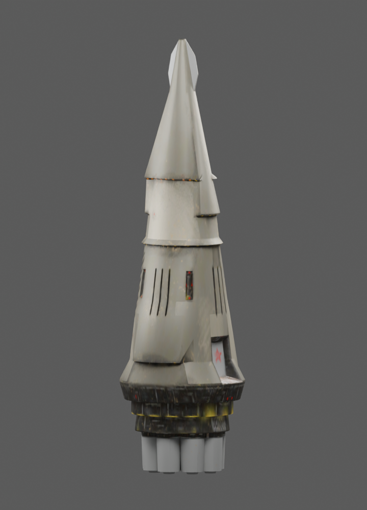
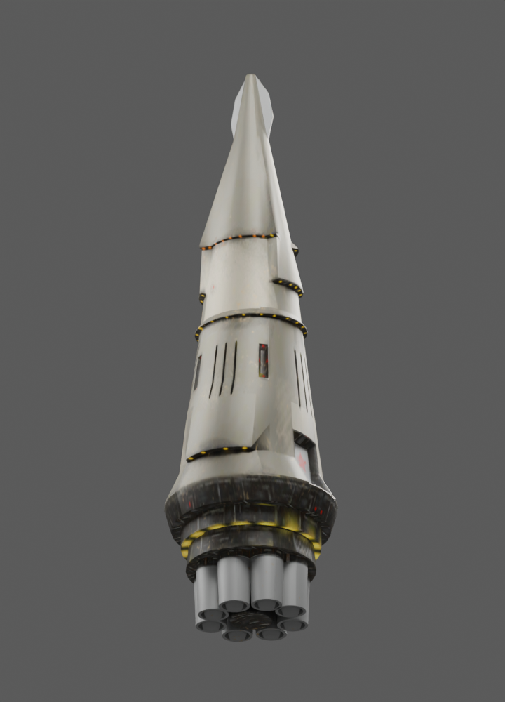

# CCA rocket compared with the Mars artwork

Comparison date: 18 October 2026. Reference: the installed
`BZ_ASSETS_CORE/common/ui/Gift/marspict.png` (640 x 480), SHA-256
`58e4336cedd89c2f8a8864cdcb6ea45706f1b5544b47a2ebc34013c36e482213`.
The rocket is `cr06rok`, adapted from Resurgence; credits and reconstruction
steps are in [the launch-film document](MISN06_ROCKET_FILM.md).

The existing model is a workable base for a closer interpretation. A replacement
from scratch is unnecessary. The largest differences are the stepped hull
profile, missing raised lamp housing, panel treatment, and how the engine
cluster is presented by the current effects and camera.

## Findings

| Feature | Mars artwork | Current model / film | Useful change |
| --- | --- | --- | --- |
| Hull silhouette | A substantial panelled main body leads into a long, sharp forward section. | Broad lower skirt with several conspicuous overlapping cone stages; the tip has a flattened, finned outline. | Give the main body a straighter run, soften the stage ledges and make the terminal nose a clean needle. Preserve the lower engine collar as the placement anchor. |
| Surface colour | Warm ivory/silver panels with dark seams, borders and mechanical recesses. | The actual base texture already has pale metal panels. The in-game shot makes them read almost black. | Diagnose runtime material, normals, lighting, camera side and Mars fog before changing the overall paint colour. The neutral render establishes that a pale base map exists; it does not identify the runtime cause. |
| Panel detail | Large readable panel outlines, access plates, longitudinal rails and small repeated fittings. | Broad hull areas have much weaker panel divisions; scratches and narrow vent slits carry much of the detail. | Add restrained large panel seams and a few raised rails/hatches that remain visible at film distance. |
| Raised housing | A rectangular housing above the main body has four conspicuous yellow lamps. | No comparably prominent housing appears in the inspected model. | Add a small raised avionics housing with four amber lenses, interpreted from the single painted view. |
| Markings and lamps | Visible red stars, a red forward band and a distinct ring of yellow engine-collar lights. | Red stars and yellow collar details already exist, but are subdued in the live view. | Make the main side marking and forward red band more readable; strengthen isolated lamp emissives rather than making the whole hull glow. |
| Engine geometry | Several large exhaust bells dominate the near end of the composition. | Eight separate open bells already form a ring. | Retain the cluster initially; improve its visibility before deciding whether bell proportions need changing. |
| Launch effects | A broad, brilliant yellow-white exhaust region illuminates the surrounding dust. | Core, plume and smoke all begin at one central point below the rocket, although the bells surround that point. | Place emission at the actual bell exits, with several white-yellow cores and orange outer plumes; retain shared world-space smoke and grounded dust. |
| Composition | A close, low view from the engine side makes the launch feel powerful. | The validated shot looks down from above to clear the foreground ridge. | Find a lower three-quarter view within the clear launch area so the engine cluster and hull panels remain visible. Keep the existing high shot as a known-working fallback. |

The artwork is a perspective painting with strong foreshortening. Exact lengths,
the hidden side and the total nozzle count cannot be established from it alone.
Its diagonal composition does not establish a tilted flight path; the existing
vertical ascent can remain.

## Neutral inspection

These renders use the actual mesh triangles, UVs, base map and emissive map in
neutral Blender lighting. They are a shape/palette study, not a reproduction of
the BZR shader, normal map or Mars atmosphere. Mesh bounds are approximately
28.27 x 97.03 x 29.99 m, with 7,332 triangles.

Compare with the [current native ignition capture](images/misn06-ignition.png).

## Suggested next prototype

1. Check the existing pale material under native lighting and test emission at
   all eight bell exits. Share particle quotas across the cluster and keep the
   existing one-event peer-local lifecycle and cleanup.
2. Make a modest mesh pass on the upper profile and add the four-lamp housing.
   Preserve the rocket's origin and nozzle plane so the map placement stays
   stable. Update native GEO/SDF companions and bounds alongside an edited mesh.
3. Refine large panel seams, markings and lamp emissives, then choose a closer
   engine-side camera. Verify the result against the artwork and in Mars fog.

This checkpoint contains the comparison and neutral inspection captures. The
validated launch prototype remains the implementation documented in
`MISN06_ROCKET_FILM.md`; the proposed art changes are the next iteration.
