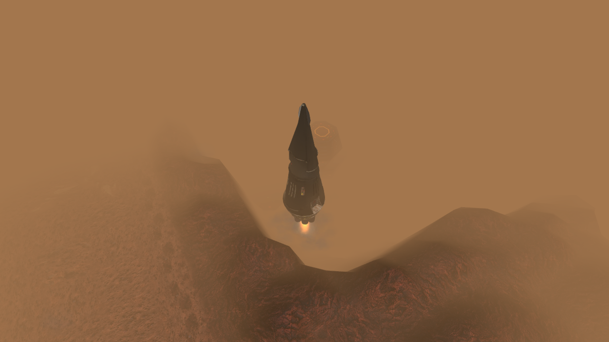
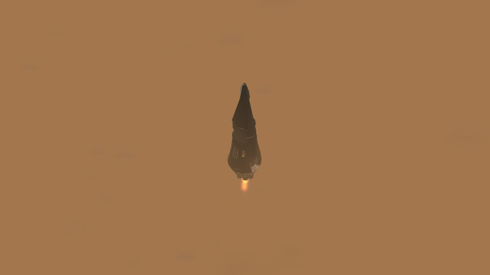

# Escape from Mars: CCA transport departure

The existing `misn0614.wav` report now has a short tracking shot of the CCA
rocket lifting out of its gantry. Its bright engine core, yellow-white plume,
world-space smoke and expanding red pad dust render locally on every peer.
The original dialogue, objective order, flight-log recon target and deadlines
are retained.

## Presentation

- `cr06_rocket` is a neutral, invulnerable map fixture, present from map load.
  Nothing is spawned in view when the cue arrives. The existing `sblpad` stays
  intact, with its original identity and team, for the later recon objective.
- One second of ignition precedes the accelerating climb. The camera follows
  the same rocket for 11 seconds. The flight continues after the camera ends;
  at 20 seconds the rocket is more than 900 m above its starting position and
  the authority removes it through the existing acknowledged presentation stream.
- As with Mission 16's takeoff, an acknowledged event makes every peer move
  its own preplaced fixture. Static-building motion is not assumed to replicate
  like a vehicle's motion. Each peer also owns and cleans its particle systems.
- Dust stays at terrain height and its emission tapers as the rocket clears
  the pad. Smoke remains in world space and dissipates after emission stops.
  The four systems have a combined quota of 1,006 particles per peer. Core and
  plume each have eight emitters aligned with the rebuilt engine bells. A local
  point light follows the exhaust when the runtime supports that API.
- A player's skip releases only their own camera in co-op. Solo skip leaves
  the flight and dialogue running. Save/load retains the launch origin and age;
  a resumed ascent does not repeat the ignition dust. Loading a completed or
  skipped view does not reopen it.
- Missing fixtures in an old save skip the insert. Unavailable optional particle
  APIs log a specific failure and preserve the rocket motion. No fixture receives
  craft AI commands, damage or an added victory/failure condition.
- The existing CCA approach-film cancellation condition is now scoped to that
  film's own active flag, so a stray cancel cannot finish another shot's camera.

## Art and reconstruction

The current rocket is a [CR-authored close study of Total Command's CCA Rocketship](MISN06_ROCKET_REBUILD.md),
with new geometry, baked materials, an editable Blender source and matching
native GEO/SDF. It has 24,760 triangles, stepped conical stages, recessed
machinery and command panels, segmented yellow lamp rings, weathered ivory
panelling and eight long engine housings with ribbed bells. Coxxon created the
Total Command reference model; its source mesh and textures are not shipped.
Original Battlezone concept-art credit remains with its creators. The owner
selected the TC model as the primary reference after reviewing the first
artwork reconstruction.

The previous prototype used **Battlezone: Resurgence** by GrizzlyOne95 and
contributors. Its author's [asset-pack description](https://steamcommunity.com/sharedfiles/filedetails/?id=3536800125)
permits reuse with credit. That extraction is retained in
`Tools/Extract-Misn06RocketLegacy.py`; it is not a dependency of the current art.

`Tools/Build-Misn06Rocket.py --blender <blender.exe> --render` reproduces the
editable source, mesh, native SDF/GEO, baked textures and nozzle layout.
`Tools/Add-Misn06Rocket.py` adds the fixture without rewriting authored blocks;
`Build-CoopMap.py --mission misn06` also calls this step automatically.
The stock Redux raised deck is measured explicitly. The fixture's nozzle plane
is centred 25 cm above that deck; the inherited wrong local X sign is corrected.
The camera moves through the clearing beside the tower and gently pulls back.

The takeoff arc, camera and particle definitions are CR-authored presentation.
They do not import Resurgence's launchpad replacement or reinforcement logic.

The follow-up [comparison with the installed Mars artwork](MISN06_ROCKET_CONCEPT_COMPARISON.md)
records the model, material, engine-cluster and camera changes that would bring
the next art iteration closer to `marspict.png`, with neutral inspection renders.

## Validation

Host checks: original mission scenarios, source parity, shared-map contract,
four-peer presentation relay, film lifecycle and VFX lifecycle. The new suites
are wired into `campaign-validation.yml`.

Rebuilt-model run `mars-rocket-rebuild-4` passes 7 steps / 23 checks on two
Windows/GOG clients: eight active bell emitters in both engine layers, all four
FX systems and the EXU physical engine light on each peer, followed by complete
cleanup. The original pad, dialogue and timers survive. The corrected deck
anchor is visible in the capture; it also exposed tower occlusion from that
camera. The TC model and revised clearing camera are the next native pass.
The shipping manager verifies all 2,764 admitted files with no differences.

The following earlier runs and captures document the Resurgence prototype.

Native run `mars-rocket-3` passed 7 steps / 16 checks on two Windows/GOG clients:
the original VO starts the insert, the rocket rises on both peers, the four
particle systems exist, the camera releases, the pad and deadlines survive,
and the actor/particles clean up. Both clients exited with return code 0.
Screenshots confirm visible orange exhaust during ascent. They also revealed a
ridge obscuring ignition in the first camera position. Run `mars-rocket-6`
passed 7 steps / 19 checks and exercised all four FX layers on both clients,
with visible orange exhaust during ascent. Its wider revised view still hid
ignition behind the ridge. The camera is now closer and looks down into the
gantry. Final run `mars-rocket-7`, after merging main through `434819b8` and
manager-deploying the combined content, passed all 7 steps / 19 checks.
Both 1280x720 ignition captures show the engine firing clear of the foreground
ridge; both peers also pass the four-layer FX and ascent checks. The 20-event
presentation streams match, the original pad and deadlines survive, and the
rocket and particles are removed. No Lua, unresolved-label or subtitle errors
were reported. The isolated deployment matches all 2,763 shipping entries.

Steam and Proton/Wine remain unverified. No Workshop upload or release is part
of this prototype.

## Resume checkpoint — 18 October 2026

Branch: `agent/mars-rocket`, draft PR #228. The prototype is complete and pushed,
including native two-peer motion/FX checks and inspected final camera captures.
Next step is the owner's visual review; no merge or live-install deployment has
been performed. Keep the draft worktree while that review is pending.
Checkpoint `91d710d3` contains the initial implementation. The isolated manager-staged content
is `C:/BZRCoop/mars-launch-20261018/content`; the regular GOG mod is untouched.
Run OpenShim's `Run-BZRCoopMission.ps1` with `-Mission misn06`, this content,
`-Scenario <this checkout>/Tools/Test-Misn06LaunchLive.ps1`, and two clients.
The scenario advances only the original launch timer, verifies the actual radio
cue, preplaced rocket, camera and all four particle systems on both peers,
then waits for departure and cleanup. Inspect its screenshots before marking
the visual result verified. Use `-MapListY 207` for the current 1280x720 map list.
Preserve other active native test sessions.

Follow-up: Claude's 19 October UTC handoff explicitly left #228 open and the
camera rerun pending. Current main was merged as `be142761`; the Mission 6 host,
relay, film, FX, source-parity, map-contract and repository checks pass together.
The shipping lock retains all 2,750 main entries plus the 13 rocket additions.
Native run 4 ended in the lobby before the mission. Run 5 reached the mission
but exposed a test-scenario name collision: its `$clients` array overwrote the
dot-sourcing runner's `[int]$Clients` parameter. The scenario now uses the unique
`$rocketClients` name. Neither failed attempt exercised the revised launch shot.
