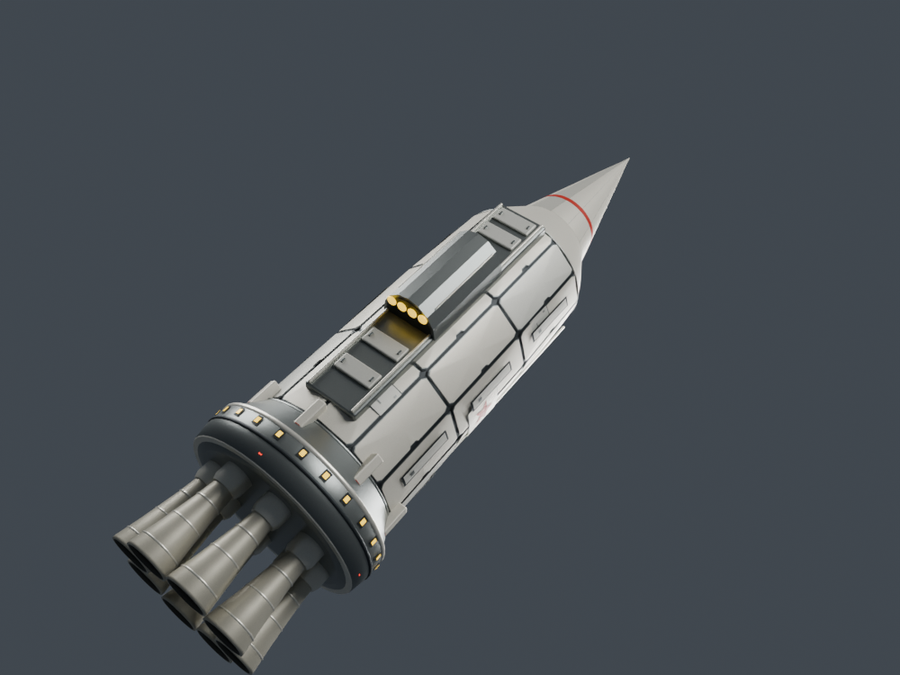

# Mars artwork rocket rebuild

The owner requested a full rebuild after the comparison with `marspict.png`.
The current geometry and textures are newly authored for CR. The first clean
cylindrical pass was too generic; the next pass corrected the dorsal housing
to face aft, added interlocking armour plates and service channels, slimmed the
nose and lightened the engine bells. The perspective inspection below uses a
low engine-side angle to make comparison with the painting more useful.

## Source and repeatable build

- Editable source: `References/Misn06Rocket/CCA-Mars-Transport.blend`, with relative
  texture paths and authored procedural materials.
- Geometry/material authoring: `Tools/Author-Misn06Rocket.py`.
- Build/export: `python Tools/Build-Misn06Rocket.py --blender <blender.exe> --render`.
  Requires Blender 4.5+ and Pillow. `--textures-only` reconverts existing baked
  maps and regenerates the bell layout and particle emitter blocks.
- Baked PNG sources, neutral views, bounds, nozzle anchors and game-file hashes
  are retained under `References/Misn06Rocket`.
- The old Resurgence extraction remains available as
  `Tools/Extract-Misn06RocketLegacy.py`; it is the previous prototype, not an input
  to this rebuilt model. Original Battlezone concept-art credit remains with
  the original creators.

## Runtime contract

The model retains the old origin, 97 m height and -48.5 m nozzle plane. It has
20,151 rendered triangles and 2,410 native fallback triangles. The native SDF
bounds cover the new dorsal housing. The four new atlases use RGBA8 DDS; the
physical geometry carries the panel relief and the normal map is neutral.

Eight bell exits generate `CR06RocketLayout.lua` and the Core/Plume emitters.
Each peer transforms those offsets using its own fixture basis. Four particle
systems share a total quota of 1,006; no extra network events are needed.
One optional EXU point light follows the engines, flickers gently and is
destroyed at shutdown. Its range is 75 m. Older EXU builds retain the clustered
particles without the optional light. Particle stops disable every emitter;
smoke/dust have a bounded four-second drain. The original mission cue and
flight, pad and recon contract remain intact.

## Checkpoint

Geometry, normal winding, native bounds, atlas formats and eight nozzle anchors
pass `Tools/Test-Misn06RocketAssets.py`. The expanded FX suite passes 322 checks,
including all bell rates, rotated fixtures, light cleanup and older-runtime
fallback. Mission 6's 1,063 host checks, four-peer presentation tests and source
parity pass. The shipping list admits exactly one additional runtime file,
`Scripts/CR06RocketLayout.lua` (2,764 total files).

Next: isolated manager deployment using the already-built EXU main checkout
that includes point lights, then two-client native captures and final framing /
material checks. Do not treat the Blender studio images as native validation.
Keep progress in this document and push each coherent checkpoint.
