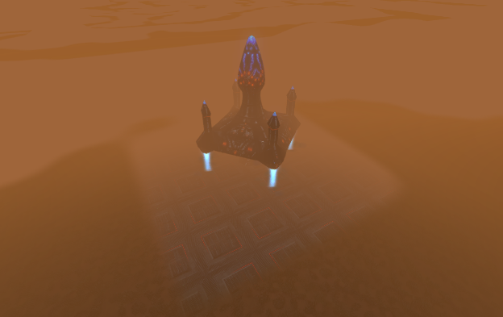
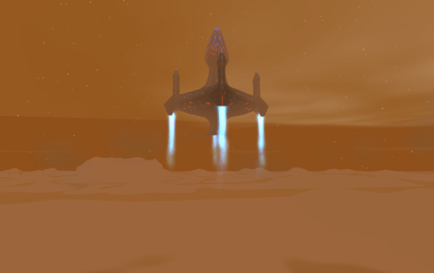

# Mission 16: Strike at the Heart

Fury roster amendment (2026-10-16): a restored `crfraz` pair is the recurring
attacker; SAT strikes and SAV counterattacks retain their roles. The optional
camera safety check includes fighters. See [Fury fighter](FURY_FIGHTER.md).

This is the shared offline / 2–4 player prototype, built on CR's amended
`misn16b` terrain and the stock selected map layout. The faithful mission body
and disabled source comments remain in `Scripts/misn16.lua`; marked dispatch
regions route play through `Scripts/CRMisn16.lua`.

## Map and ownership

- Humans occupy teams 1–4; Texas, the initial NSDF base and CCA reinforcement
  groups remain shared, host-owned on team 1. Furies and corrupted structures
  use team 6. Guest teams never receive strategic AI.
- The ten CCA base structures use `cr16cmd`, `cr16hng`, `cr16pwr`, `cr16tow`.
  Both tower hardpoints have 200 m Bolt Buddies. Global stock models are intact.
- `Missions/misn16b.*` remains the amended input/art baseline. Runtime terrain
  `misn16.*` is derived from it: only 24 height samples and 54 material tiles
  change for the pad/apron. TRN adds the stock Titan type-1 base atlas binding;
  LGT is copied unchanged. No wholesale stock terrain replacement is performed.
- The runtime map has 145 objects and 21 named paths: four stationary human
  starts, the stock defenders and labels, the transport assembly, a camera
  target and two staged evacuation SATs. Snapshot motion/orders and two
  unnamed runtime paths are removed. Bootstrap reissues only known craft orders.

## Evacuation finale

The pad centre is `(3900, 5, 100000)`, east of `edge_path`'s maximum X
`3413.33`. Its 120 m square uses `TI11SA0` / `TI11SB0`, with a short western
apron. Mission 18 supplies the `hbtran00` hull and four `hbtrn200` thrusters;
their relative positions and rotations are copied from that map. No new hull
geometry, opening hatch or interior is claimed.

The hull, engines and two evacuees exist from mission load. The first facility
loss sends the SATs along `cr16_evac_route` to a holding point northwest of
the transport. Final boarding waits for both facilities to fall, so the Furies
are still present when the cinematic begins. The second actor is held briefly
so the approaches do not interfere. Both the staging route and final boarding are scripted ground-craft movement,
so the native enemy AIP cannot divert these actors toward the human base.
The final approach enters the north boarding pockets concealed by the broad skirt. Boarding removal is restricted to a pocket behind the northern
engines, reached in sequence, with no human within 400 m. The authored camera
paths stay on the south side. A blocked or observed evacuee is left in place;
there is no teleport-to-board fallback.

Both facilities destroyed latches the earned assault victory. It stops further
mission waves, queues the completion and boarding dialogue, and offers the
shared `cr16_evac_cam` shot when every human is clear of close combat. After
the audio and boarding wait, `cr16_launch_cam` watches departure. The concealed camera pod is removed before it could be exposed by lift-off.
The static hull and engines receive the same increasing vertical translation on each
peer after an acknowledged launch event; they never receive unit AI commands.
The launch shot ends before the ship goes far above the fog horizon. At 900 m
rise the assembly is removed and one shared result is delivered.

Takeoff now ignites visible exhaust at all four engine nozzles. The
mission-local `CRMisn16LaunchFX` attaches a plume and a bright nozzle core to each
engine at the stock mesh's lower end (12 m above its model origin). Spent
particles stay in world space. Four dust patches remain anchored to the pad;
their emission fades out once the hull has risen 45 m, with the remaining dust
destroyed after 11 seconds. Short, zero-damage cyan ignition light particles
follow the nozzles during the visible launch shot. Exhaust remains active until
departure, including when a player skips their camera. The nozzle cores and
flight plumes use a mission-local Fury blue material with
neutral emitter RGB, so the hue survives the sprite shader's backend-specific
vertex-color channel order. Ground dust retains its existing treatment.

Each peer creates these bounded local effects from the existing `EvacLaunch`
presentation event; no additional gameplay objects or network events are spawned.
The particle payload is loaded only when the launch needs it. Missing optional
FX APIs/templates degrade without blocking the earned victory. Result, restart,
missing transport and engine destruction clean the effects; loading an already
airborne launch does not replay ground ignition. No models or shared shaders
were changed for this addition.

`transport-fx-20` passed **8 steps / 25 checks** on two native GOG clients, with
four live plume/core/dust systems on each peer, native emitter rate readback,
light pulses, ground-wash cutoff, attached engine movement, departure cleanup,
and one victory on each peer. Both clients exited normally. Logs contained no
new launch particle/Ogre exceptions; existing stock `TestGround.material`
missing-reference diagnostics remained. `Test-Misn16LaunchFX.lua` adds 45 Lua
lifecycle checks alongside the 411 mission and 60 scene checks. Four-player,
Steam and Proton/Wine launch-FX validation remain unverified.

The final Fury blue material passed the same **8 steps / 25 checks** in
`transport-fury-blue-22`. Both native DX11 peers showed blue-white nozzle cores
and cyan exhaust, exited with return code 0, and logged no new Ogre errors.
The screenshots below are unchanged captures from that final run. The neutral
particle RGB also avoids the SM3 color-order difference; native DX9 rendering
has not been verified.

| Ignition and pad wash | Visible flight exhaust |
| --- | --- |
|  |  |

Each player may skip their own camera without changing shared boarding,
launch or result timing. A survivor who cannot board does not block victory.
Destroying the optional transport does not invalidate the completed assault.
Texas loss takes precedence if it coincides with the final facility loss;
after the assault victory latch the epilogue cannot revoke it.

## Dialogue and other source deltas

Restored stock English WAVs are shipped byte-exact for languages whose stock
archives omit these unused lines:

| VO | Trigger |
| --- | --- |
| `misn1609` | First counterattack actually enters the map |
| `misn1610` | Texas counterattack actually enters the map |
| `misn1611` | Twelve minutes without either facility falling |
| `misn1614` | Reinforcement exhaustion while a facility remains |
| `misn1615` | Completed assault's boarding/escape scene |
| `misn1616` | Hangar destruction, once |

Nine reinforcement manifests, source type-5 fallthrough and its double radio,
decreasing SAV gap, coupled SAT timing and both counterattack gates remain.
Arrivals are queued at off-boundary ingress sites, with at least 460 m from
every human and no active shared camera before building a group. The extra
margin covers the group's spawn offsets; Titan's terrain horizon is 250 m.
No unsafe native AI setter is applied to the scene fixtures. Soviet human
craft are never auto-ordered by an AddObject callback.

The scene is new CR staging supported by unused VO and the success debrief,
not recovered executable escape logic. Disabled extra combat units and N64
Pilot Mode remain outside this prototype.

## Validation

- Lua 5.1 parsing passes for the runtime and wrapper.
- Faithful reference: 411 behavior checks and 99 source checks pass.
- Scene/ordered transport: 58 checks pass with the real co-op registry in a
  mocked four-peer world, including local skip, loss tie, optional ship loss,
  stranded actors, save/load resumption and watched ingress deferral.
- `Tools/Test-Misn16Live.ps1` is the bounded native boarding/launch/result
  scenario. Its explicit assists destroy the facilities, clear combat
  Furies so the optional safe camera can play, and heal human craft;
  it does not certify natural combat balance.

Native evidence is recorded in `Docs/MISN16_NATIVE_20261016.md`: four-client
progression passed before final camera/choreography adjustments; the final
two-client run passed both boarders, both cameras, lift and one shared result.
Full reinforcement permutations, human multi-PC play,
native save/load and Steam/Proton/Wine qualification are not established by
the Lua tests. No Workshop upload or release is part of this workstream.
