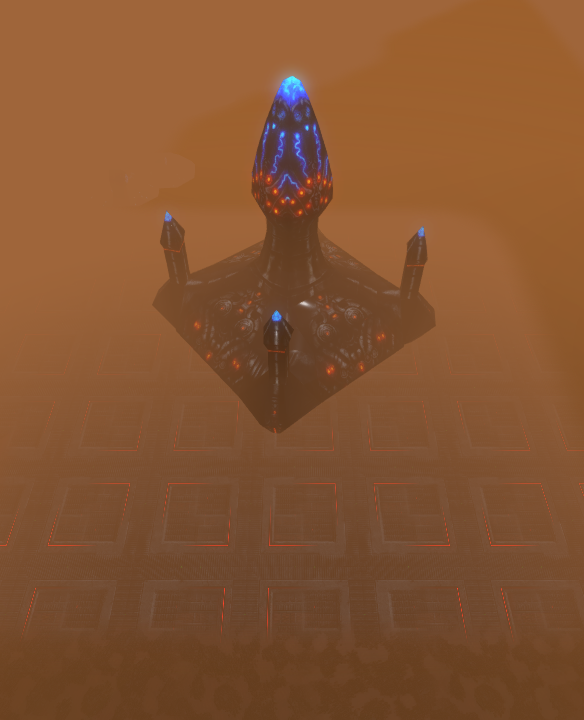
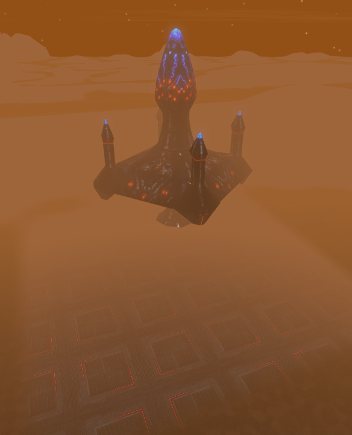

# Mission 16 native prototype evidence — 16 October 2026

Private GOG 2.2.301 loopback clients, windowed DX11 Enhanced, through the
OpenShim co-op harness. Normal player installs were not used as staging.

| Run | Scope | Result |
| --- | --- | --- |
| `misn16-scene-four-4` | Four native clients: map/registry, evacuation, attached hull/engines, one shared result and native sequence diagnostics | PASS: 7 steps, 46 checks. This precedes final actor route and camera refinements. |
| `misn16-scene-final-9` | Final runtime/map, two native clients: both boarders before launch, both film phases, attached engines and one shared result | PASS: 7 steps, 22 checks. No Lua errors, Ogre exceptions or unresolved scene handles. Normal graceful shutdown. |

In the final run, both evacuation actors were removed at simulation time 47.89,
at the concealed north pocket (one at full health, one at 99%). The camera pod
was removed at 55.23 when launch began. This establishes both boarding events
before departure; there is no timeout teleport or mid-flight absorption. The
rendered boarding and launch views are retained below.

The final run used the frozen source hashes:

- `Scripts/CRMisn16.lua`: `75c0ebf0644831fb7dfc43b5a0b45ef9ef3a458b10182d0ed88ee5a54ccf4b62`
- `Missions/misn16.bzn`: `047d6efdc6bbfebf143a011db5325e5a3df5c2382ed08a67c78961964a24a6fa`

Evidence folders are local under `C:/BZRCoop/qualification-20261016/runs/` with
the run names above. `Tools/Test-Misn16Live.ps1` is the repeatable scenario.
Earlier iterations tested boarding pockets, Fury type behavior, camera safety
and terrain occlusion; their failures are not counted as passes.

Test assists destroy the two facilities, remove other Fury combat craft to
permit the optional safe film, and heal the human vehicles. The clients were
muted; the harness verified active audio/timing availability, not an audible
mix or recording. These are progression/presentation checks, not natural
combat balance, full four-human multi-PC play or every reinforcement branch.
Final actor choreography was natively repeated with two clients; its final
four-peer decision/transport logic is covered by the 58-check Lua simulation.
Native save/load, widescreen capture review, Steam and Proton/Wine remain
unverified. No merge, Workshop upload or release was performed.
