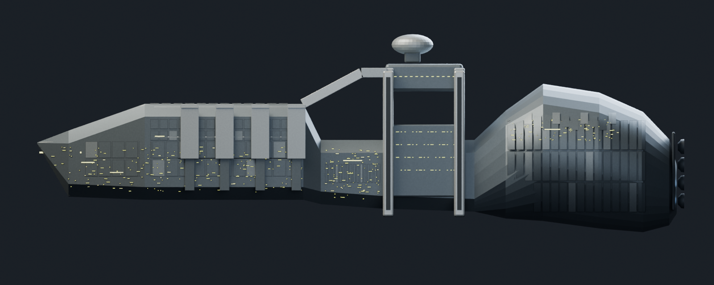

# NSDF carrier concept study

The owner requested a carrier for a future cutscene, using `Nsdf_carrier.webp`
from the local BZ1Concept archive. `CCAfleet3.webp` is the accompanying faction /
fleet comparison. See `CONCEPT_FLEET_ASSETS.md` for the three CCA capital ships
and the owner's clarification that the five small objects are stock scale units.
The NSDF carrier is a standalone cinematic asset; no campaign
mission is changed and no mission placement has been selected.

The side-view survey preserves the wedge bow, stepped forward armour, paired
central frames, diagonal upper spar, open rectangular gap and large rounded
afterbody. Window lights are sparse yellow slits and dots. Source artwork stays
private and unchanged; geometry and baked materials are authored here.

## Inputs and inferences

The reference has no dimension scale, plan view or visible engine bank. A 240 m
bow-to-stern concept span is an authored staging choice, with about 59 m beam.
This replaces the initial 600 m draft after using the owner's identified stock
`svapc` comparison to estimate about 240 m for the CCA capital carrier.
The eight recessed aft engines, depth, upper radar fitting and unseen surfaces
are inferred. Do not present these dimensions as canonical Battlezone lore.
The engine mouths extend 2.8 m aft of that 240 m span.

The source filenames and SHA-256 hashes are in
`References/NSDFCarrier/geometry.json`, together with the measured pixel stations
and game-local engine exits. The procedural authoring script rebuilds from that
survey without requiring the private images on another machine.

## Asset and build

- Runtime object: `crncarr` (`ODF/crncarr.odf`), neutral static `i76building` fixture.
  No AI, production, weapon or damage role is added.
- Ogre/native geometry: `Assets/ModelFixes/crncarr.{mesh,geo,sdf}`.
- Material: `Materials/crncarr.material`, with namespaced diffuse, emissive,
  specular and flat-normal RGBA8 atlases under `Assets/Textures`.
- Editable source: `References/NSDFCarrier/NSDF-Carrier.blend`, with relative
  texture paths. Baked PNG sources and three inspection views are beside it.
- Repeatable build: `python Tools/Build-NSDFCarrier.py --blender <blender.exe> --render`.
  Requires Blender 4.5+ and Pillow. `--textures-only` reconverts existing bakes.
- Native geometry uses coarse closed structural solids, not every tiny light
  and service cover; both native vertex and face counts remain below 4,096.

Blender uses X starboard, Y toward the bow and Z up. The exported asset has Y up,
bow at local -Z and engines at +Z. Its origin is the main hull reference centre.
The mesh, native SDF bounds and engine exits use the same pivot.

## Cutscene use

Preplace the object off-camera before the shot. Use a neutral team and apply
only transform/camera operations; do not pass it to `Stop`, `SetIndependence`,
weapon or craft-AI helpers. In co-op, preplace one shared fixture and translate
each peer's local actor through the mission's acknowledged presentation stream.
Host movement of a static building is not assumed to replicate like a craft.

The existing emissive windows and blue engine throats work without scripted
effects. Eight game-local engine-mouth positions are retained in the source
manifest for a future cutscene's exhaust. No new particle system runs globally.
Large carrier shots also need a deliberate fog / terrain horizon and camera
distance; close ground-mission fog can hide the whole ship.

## Preview and pickup

`Tools/Build-CarrierPreviewMap.py <override-folder>` creates an isolated copy of
`misn06.bzn` with a preplaced carrier at (1700,650,100900). It cannot overwrite the
campaign map. `Tools/Test-NSDFCarrierLive.ps1` frames side, bow and aft views,
then demonstrates a bounded owner-local flyby on both clients. Its temporary
camera and far fog are test-only and are released afterward.

Build with the manager into `C:/BZRCoop/nsdf-carrier-20261018/content`, using
the deployed-main OpenShim and EXU runtime overrides. Pass the preview-map folder
to the native runner's `-ContentOverride`, `-Mission misn06`, `-Clients 2` and
`-MapListY 207`. The manager initially fell back to the normal GOG development
mod because the new override folder did not exist. Its bootstrap refreshed 13
existing managed files from main / pinned runtimes, and the next deploy added
the nine carrier resources. No mission placements were changed. The explicit
test-content folder now exists; subsequent native staging uses that isolated
path. No Workshop upload or release was performed.

Current state: corrected-scale authored model and loader invariants pass;
shipping admission and four-ship native captures are being checked. Branch
`agent/nsdf-carrier`, based on main `521c6e80`; the rocket stays in separate PR #228.

